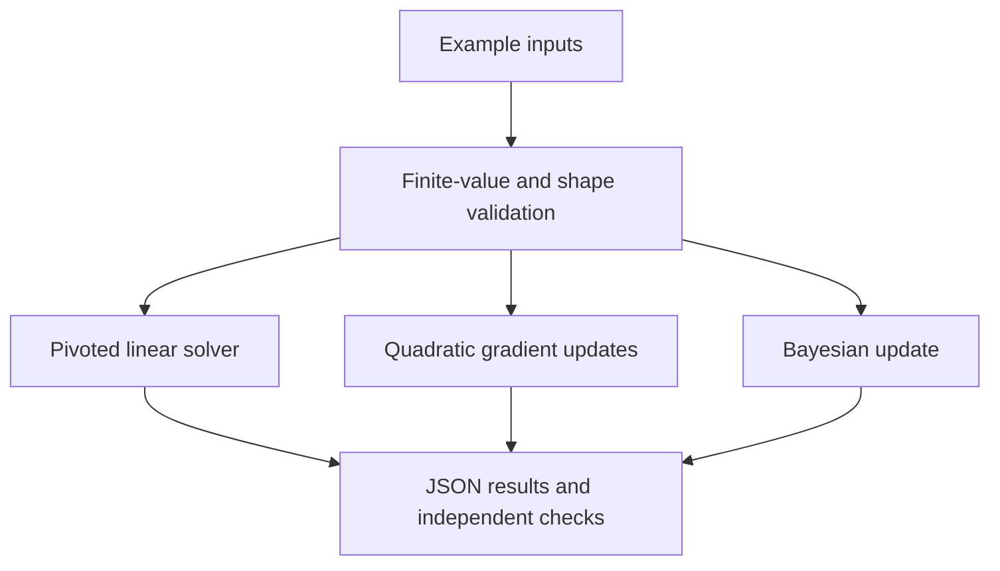

# Study implementation and engineering decisions

Edition: **14 November 2026**, AI-assisted. The original mathematical coursework remains academic evidence. This small Python implementation reproduces selected non-personalised examples and adds one synthetic Bayes example.

## Structure



The command `python -m src.workbench` produces deterministic JSON. It uses the Python standard library, performs no network requests and needs no API key, dataset or service. Tests import the same calculation functions. There is no web deployment to claim.

## Numerical contracts

| Function | Input | Output and failure behaviour |
|---|---|---|
| `solve_linear_system` | Nonempty square finite real matrix and matching right-hand side | Solution vector; copies inputs; rejects invalid dimensions, non-finite values and pivots too small relative to the largest original coefficient |
| `gradient_descent` | Finite start, learning rate strictly between 0 and 1, integer steps from 0 to 10,000 | Initial state plus per-step position, objective and gradient for the fixed quadratic; rejects invalid bounds and non-finite intermediate values |
| `bayes_posterior` | Three probabilities in [0,1] | Posterior under two exhaustive hypotheses; rejects evidence with zero probability |

Boolean inputs are rejected as numbers. Floating-point arithmetic introduces rounding; test assertions use justified tolerances rather than literal decimal-string equality.

## Decisions and tradeoffs

**Keep original and new work distinguishable.** The assignment is an ODT with an explicit redaction receipt. The new code is labelled 2026 throughout. No newly written function is represented as assessed source.

**Expose the mathematical steps.** Gaussian elimination uses partial pivoting and back substitution. It does not explicitly invert the matrix. Gradient descent returns a trace rather than hiding its intermediate states. The Bayes example is synthetic and identifies all three inputs.

**Check against independent expectations.** The assignment linear system has known solution (5,-1,-5), which is also substituted into the original equations. Tests check pivoting, consistent rescaling and invalid/singular inputs. Gradient checks include analytic minimum and the known first three updates. Bayes tests compare a hand-derived fraction and zero-evidence cases.

**Keep the runtime minimal.** The implementation uses the standard library to expose the algorithm for study. It does not recreate the historical NumPy environment or claim equivalence to a production scientific solver.

## Limits

The linear solver uses O(n^3) work and O(n^2) storage, without sparse methods, a condition-number estimate or a stability guarantee. Near-singularity depends on the chosen numerical threshold. It is intended for small educational systems. Overflow can make otherwise finite input problems unrepresentable; input finiteness alone does not guarantee a successful solve.

The gradient function supports one convex quadratic, not arbitrary model training. Its learning-rate restriction is specific to that objective. The Bayes function assumes two complementary hypotheses and supplied probabilities; it does not estimate their validity. These examples establish no real-world predictive performance.

## Verification

```bash
python -m unittest discover -s tests -v
python -m src.workbench
python scripts/verify_repository.py
```

GitHub Actions runs these checks on pull requests and main. Artifact verification checks the exact assignment hash, ZIP/XML structure, removal of the personalised embedded object and screenshot, and local Markdown links. These checks do not visually render the ODT or independently grade every original calculation.

## Authorship and maintenance

Original coursework: Jyothesh Karnam, 2023/24. Code, tests, redaction and portfolio documentation: later AI-assisted maintenance dated 14 November 2026. Preserve the originals locally, update hashes when intentionally changing the public copy, and state new edition dates explicitly. Keep transcripts, student identifiers and real personal datasets out of commits.
